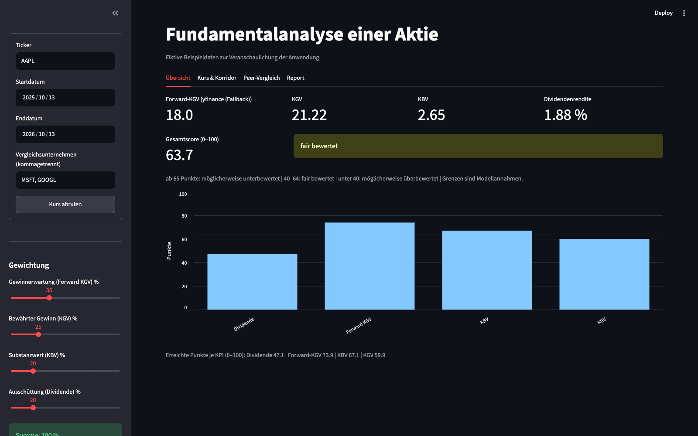
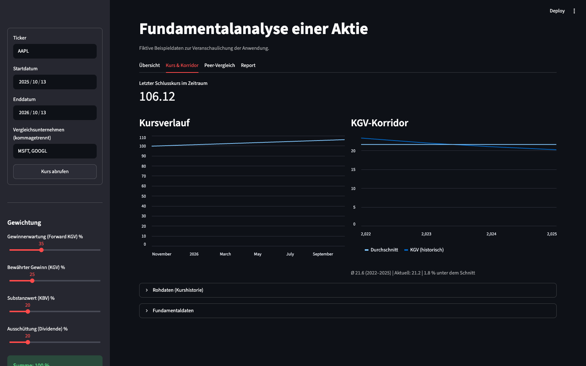
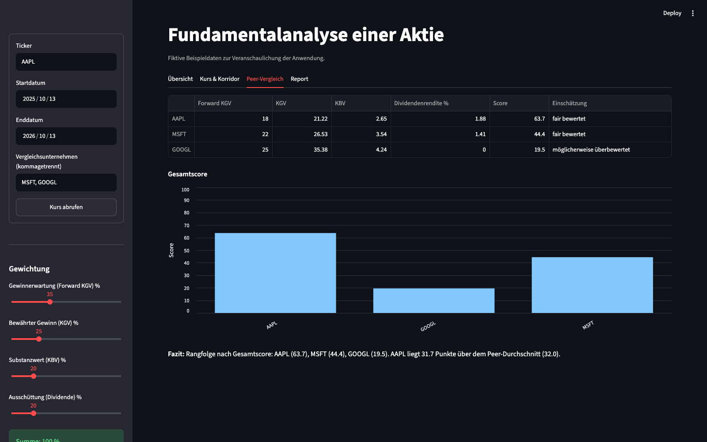

# Stock Fundamental Analysis

**Retrieve stock fundamentals, calculate a transparent scoring model and compare companies.**

[Deutsch](README.md) · [License](LICENSE)

A Python project by **Yakub Uyar**. The German Streamlit interface combines
data retrieval, ratio calculations, interactive charts and PDF export. It
shows how ratios and weights affect a model assessment. Results are not
investment advice or recommendations to buy or sell.

## Screenshots

These screenshots show the running application with **fictional sample data**.
Ticker symbols illustrate the inputs; displayed values are not actual market
prices or company valuations.

### Overview

Ratios, an individual overall score and ratio points with adjustable weights.



### Prices and corridor

Closing price history and historical P/E values with an average reference line.



### Peer companies

A shared ratio table, scores and ranking of the selected companies.



## Features and technology

- Enter a ticker, date range and peer companies
- Retrieve price history and fundamentals through yfinance
- Extract forward P/E from Finviz, with yfinance as a fallback
- Calculate P/E, P/B and dividend yield
- Normalize four ratios to 0–100 points and set individual weights
- Normalize weights to a total of 100%
- Compare historical P/E values using annual EPS and year-end prices
- Download a PDF report with ratios, weights, charts and peer comparison

| Area | Implementation |
| --- | --- |
| Interface | Streamlit with a form, session state, sliders and four tabs |
| Data | yfinance, plus Requests and Beautiful Soup for Finviz |
| Processing | Pandas for price series and comparison tables |
| Charts | Altair in the interface, Matplotlib for the report |
| PDF | fpdf2; charts and reports are generated in memory |
| Tests | unittest and Streamlit AppTest with controlled data sources |

The application remains in `app.py`. The main stock and peers use the same
calculation functions. Retrieved data persists within the session; changing
weights does not require another data request.

## Scoring model

| Ratio | Calculation | 100 points | 0 points | Default weight |
| --- | --- | --- | --- | --- |
| Forward P/E | Data-source value based on expected earnings | ≤ 12 | ≥ 35 | 35% |
| P/E | Closing price / earnings per share | ≤ 12 | ≥ 35 | 25% |
| P/B | Closing price / book value per share | ≤ 1.5 | ≥ 5 | 20% |
| Dividend yield | Annual dividend / closing price × 100 | ≥ 4% | 0% | 20% |

Values between the thresholds are normalized linearly. The overall score is
the weighted sum. Scores of 65 or higher are labelled “possibly undervalued”,
40 or higher “fairly valued”, and lower scores “possibly overvalued”. These
are fixed model assumptions, not empirically validated signals. Missing ratios
prevent the overall score and PDF export. A confirmed zero dividend is valid;
a missing dividend value remains unknown.

## Run locally

Requirements: **Python 3.12** and internet access for installation and data
retrieval. No API key, `.env` file or database is required.

```sh
git clone https://github.com/Yakub-Tech/aktien-fundamentalanalyse.git
cd aktien-fundamentalanalyse
python3.12 -m venv .venv
source .venv/bin/activate
python -m pip install -r requirements.txt
python -m streamlit run app.py --server.address 127.0.0.1
```

On Windows with Python 3.12, create and activate the environment with:

```powershell
py -3.12 -m venv .venv
.\.venv\Scripts\Activate.ps1
```

Then use the same installation and start commands beginning with `python`.
Open `http://localhost:8501`, enter for example `AAPL` with `MSFT, GOOGL` as
peers, choose a date range and click **Kurs abrufen** (retrieve prices).
The end date is exclusive. Adjust weights and use **Auf 100 % normalisieren**
(normalize to 100%) when needed. The PDF download is in **Report**.

Stop with `Ctrl+C`; leave the environment with `deactivate`. The application
has no persistent storage of its own. Back up downloaded reports yourself;
yfinance may create local connection and timezone caches.

## Development and checks

```sh
python -m unittest discover -s tests -v
python -m compileall -q app.py spikes tests
```

Tests cover calculations, missing values, weight normalization, input validation,
analysis, peer comparison and PDF generation. External sources are replaced
with fictional fixtures. GitHub Actions runs these checks on Python 3.12
without needing access to Yahoo or Finviz.

```text
app.py                  Data retrieval, calculations, interface and PDF
requirements.txt        Specified dependencies
.streamlit/config.toml  Dark interface theme
tests/                  Calculation and interface tests, sample data
spikes/                 Original library experiments
assets/screenshots/     Views of the running application
.github/workflows/      Automated checks
```

Early experiments in `spikes/` are outside the main flow. Run them with
`python spikes/spike_yfinance.py`, `python spikes/spike_bs4.py` or
`python -m streamlit run spikes/spike_streamlit.py`.

## Limitations and safe use

- Yahoo and Finviz may block or limit requests or change their interfaces.
  Missing prices are reported; Finviz failures use the fallback.
- The main stock uses the last closing price within the selected range.
  Fundamentals and peer prices are retrieved at request time. An old date
  range therefore does not reconstruct the company's valuation at that time.
- The historical corridor uses December 31 as its reference and only available
  positive annual EPS. Fiscal year ends may differ; few data points and missing
  years limit its usefulness.
- The model does not adjust for industries, currencies, growth, debt or
  qualitative factors. Peers are selected manually.
- There is no login. The documented start binds the application to the local
  computer. Public server operation requires separate safeguards.
- The software license grants no market data rights. yfinance notes personal
  use of Yahoo data. Provider terms must be checked separately before
  redistribution or business use of data. See [third parties](THIRD_PARTY.md).

## License and responsibility

Copyright © 2026 **Yakub Uyar**. The [custom bilingual license](LICENSE) permits
viewing, downloading, own use and modification, and free distribution with
source code and notices. Associations and businesses may use the original code
for their own work. Selling the software or derived versions and providing
paid software services require express permission. Third-party rights remain
unaffected. This is not an open-source license.

Use at your own risk, as is and to the extent permitted by law. Review suitability,
calculations, security, privacy and applicable requirements before real use.
Operators are responsible for setup, access permissions, operation, backups
and restoration. Maintenance, support and specific results are not promised.
Mandatory warranty and liability rights remain unaffected.
